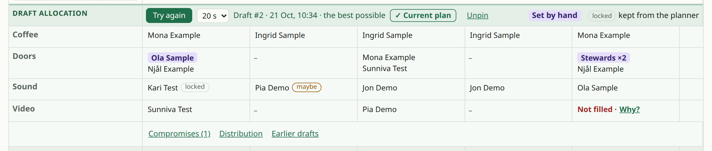
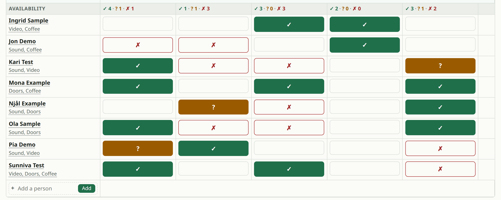
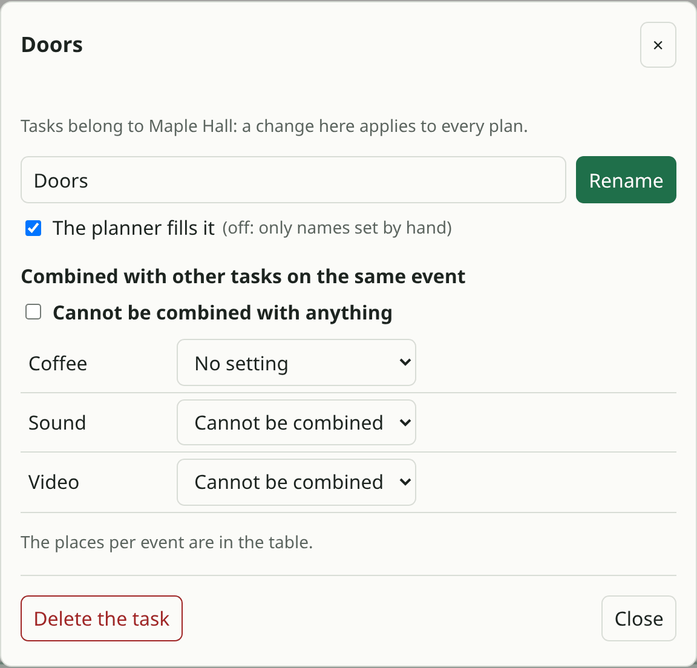
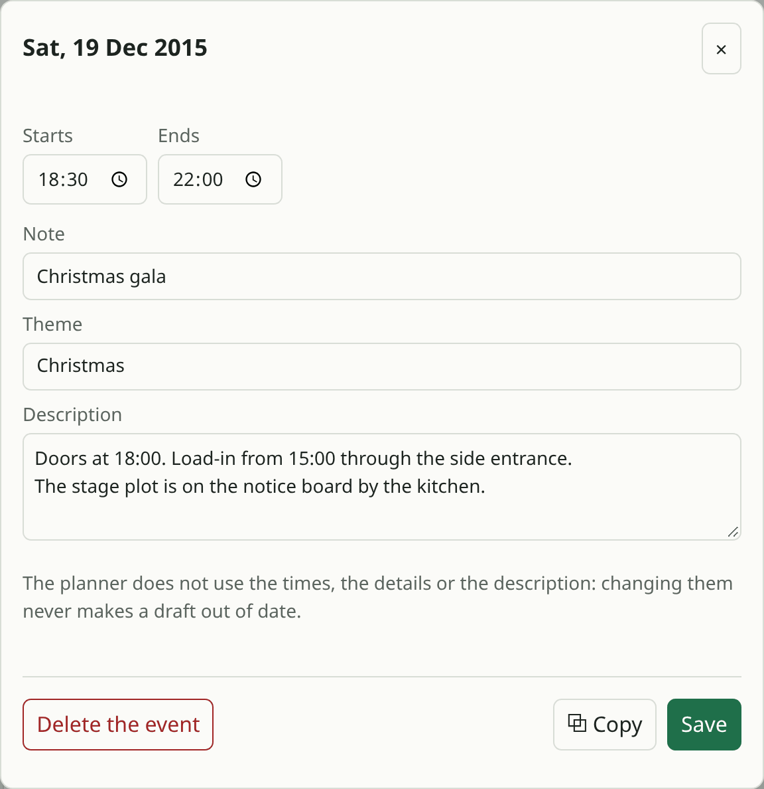
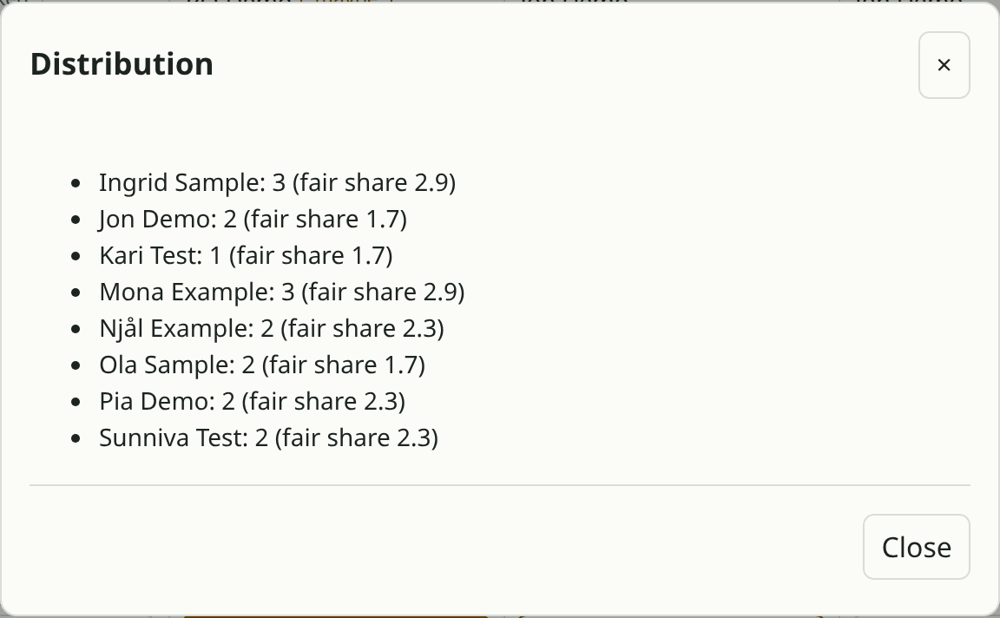
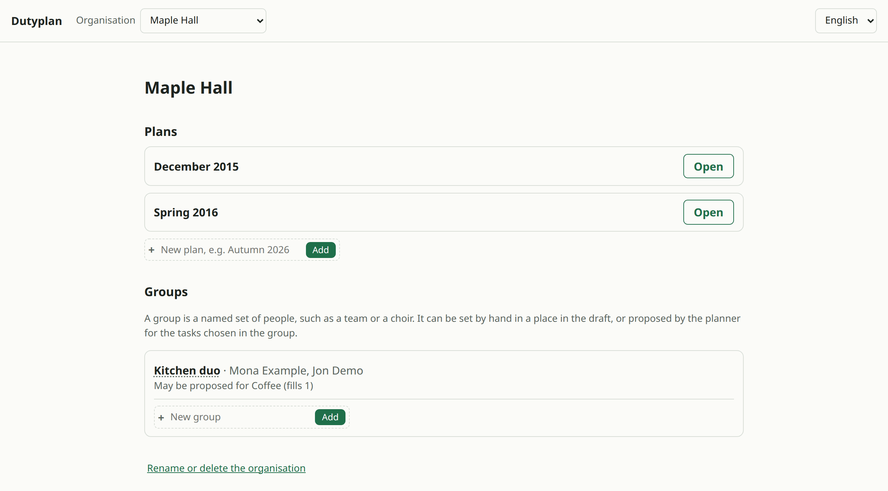
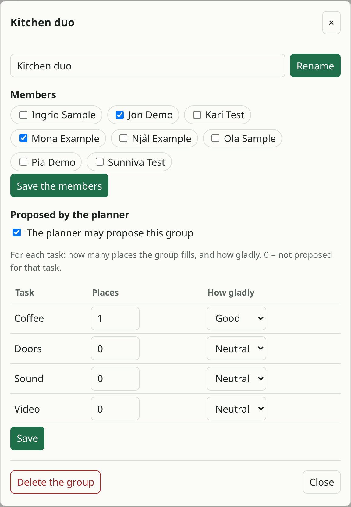

# Dutyplan

**Share out recurring duties fairly, and know why.** Who runs the sound on which Saturday, who is on the door, who brings the
coffee? People say what they can take part in and when they cannot; a planner proposes who does what as evenly as it can,
and tells you why a place stays empty.

[](LICENSE)


*Dutyplan* (*Tjenesteplan* in Norwegian) is a general tool. Tasks, people, groups, events and the details shown for them are
all things you create yourself. The pictures here show a made-up community hall, *Maple Hall*, with invented people.

## The problem

A rota made by hand is a puzzle that never stays solved. Some people cannot on some days, some would rather not, two jobs
cannot be done by the same person on the same evening, a couple wants to work together, and somebody always ends up with twice
as many turns as the rest. Every change means starting again.

Dutyplan keeps the facts in one place and lets a constraint solver (OR-Tools CP-SAT) do the puzzle: press **Make a draft** and
you get a proposal that follows every hard rule, is as even as it can be, and says so when it cannot fill a place.

## What it does

**One table for the whole plan.** The plan page is a table with the events across. Read a column from the top: what the event
is, what it needs, who got it, and who can come. Two events can fall on the same day.

**Event details are yours.** Below the date and time come the plan's own rows (a note, a theme, who hosts: whatever you need).
You add them yourself, type straight into the cells, drag ⋮⋮ to move a row, and ✎ renames, moves or deletes it. The planner
never reads them.

**Each event has its own places.** A *task* is something to do (Sound, Video, Doors, Coffee). For every task and event you
type how many places there are: a concert needs two on the door, a rehearsal none. Nothing is built in.


**The draft allocation.** Between the tasks and the answers is the draft: who has each place. What you set yourself has a
violet background: a person, a group, or a text such as *Stewards ×2* that fills places without being anyone. A name from the
planner can be **locked** with one click, and *Try again* keeps it. A place given against a *?* is marked *maybe*, and a place
that cannot be filled says *Not filled · Why?*. The planner is checked afterwards by a second, independent program, and the
page says if a rule was broken (it should never be).



**Everyone answers in the same table.** Under *Availability* each event has a count of the answers, and each person a row. Click
a cell for ✓ *yes*, again for ? *maybe*, again for ✗ *no*, and once more to clear it; an empty cell is not answered and counts as
neutral.



**It says why.** Click a place in the draft and you see what is set by hand and what came from the planner, can set a place by
hand, and can say that the planner picks only from some people (*their own sound engineer*, without any special rule). When a
place cannot be filled, the reason is in plain words: who is outside the selection, who cannot come, who has not chosen the task.
Weak spots the planner had to accept are listed as *compromises*.


**The rest is one click away.** The name of a task opens what it can be combined with on the same event (or *nothing at all*)
and whether the planner fills it. The name of a person opens the tasks they take part in and how willingly. A date opens the event's times, details and description.





**Events are easy to copy.** ⧉ on an event copies it to other dates, or every week until a date, with the times, the details,
the places and the names set by hand if you want them. Answers are never copied. **+** after the last event adds a new one,
empty or as a copy, also every week.


**Fair, and yours to tune.** «Even» means an equal *total* load: someone who only takes one task does not end up with half of
someone who takes two. The distribution shows how many turns each person got against their fair share. The weights behind the
proposal are configuration per plan, under ⚙ *Plan settings*, with defaults that work and limits that keep them sane.



**Every draft is kept, and one is the current plan.** Try again and compare. **Pin** a draft as the plan's current plan: the
page opens with it; with nothing pinned it opens with the newest. The earlier drafts are under ⚙,
with the weighting and the plan's name.


**Groups.** A *group* is a named set of people who work as one: a team, a couple. It can be set by hand in a place, or proposed
by the planner for the tasks you choose; the members are busy together, and each counts as having worked.




**English and Norwegian, on a phone.** The page follows the browser's language and has a switch in the header; the
explanations the planner writes follow it too. On a phone the availability is turned: events go down and people across, so a
tap answers, and under each answer are the tasks that person has in the draft. The rest of the table follows below it and scrolls
sideways under the row names.


**Small to run.** One Go binary with the web page inside it and a SQLite file; the planner is a separate Python program that the
server starts when you make a draft. **No login**: read the warning below before you put it anywhere other people can reach.

## How it works

1. An **organisation** holds everything that is shared: people, tasks, groups and which tasks can be combined.
2. An organisation has several **plans** (for example *December 2026*). A plan is a list of **events**, shown as one table.
3. Everyone answers in the plan's table (there are no user accounts: a person is a row, and anyone with the address can fill it in).
4. **Make a draft** runs the planner. Set places by hand, lock names, choose whom the planner picks from, change the weighting,
   and try again.
5. Each draft is kept. **Pin** the one you want to use.

Everything you create can be renamed, and plans and organisations can be deleted (an organisation only when it has no plans).

## No login: where to run it

Anyone who can reach the address can read and change **everything**, and nothing records who did it. So:

- run it on a network you trust (a home or office LAN), or
- put it behind a reverse proxy that does the authentication (HTTP basic auth, an identity-aware proxy, a VPN), and do not
  expose the port itself to the internet.

The server refuses writes from other sites (`Sec-Fetch-Site: cross-site`), and sends `X-Robots-Tag: noindex` and a strict
Content-Security-Policy, but that only keeps other pages and search engines out; it is not authentication.

## Requirements

| What | For | Version |
| --- | --- | --- |
| Go | building the server | 1.26 |
| Python with [OR-Tools](https://developers.google.com/optimization) | the planner (optional: without it everything works except **Make a draft**) | 3.12 (newer ones that OR-Tools has wheels for also work) |
| [mise](https://mise.jdx.dev) | the easy way to get both, pinned (see `mise.toml`) | recent |

The database is SQLite through a pure-Go driver, so there is nothing to install for it.

## Quick start

With mise:

```sh
mise install            # Go, Python and uv, in the versions pinned in mise.toml (once)
mise run up             # installs the Python packages, builds, starts on http://127.0.0.1:8080 and prints the address
```

`mise run up` is the whole thing in one command, and the only one you need after `mise install`. When the database file
(`dutyplan.db` in the current directory, or the one named by `--db`) does not exist yet, it first gets a small demo
organisation, *Test*, so there is something to look at. Arguments go to the server: `mise run up -- --addr 0.0.0.0:8080 --db /var/lib/dutyplan/dutyplan.db`.
Stop it with Ctrl-C.

The steps one by one: `mise run setup` (the Python packages, OR-Tools, for the planner), `mise run app:run` (starts the server
without building a binary or seeding), and `mise run app:seed -- http://127.0.0.1:8080` (fills a running server with the demo
organisation). `mise.toml` sets `DUTYPLAN_SOLVER` so that the server finds the planner. Open the address, create an
organisation (or use *Test*), create a plan, add events, tasks and people in its table, type the places, let people answer,
and press **Make a draft**.

Without mise:

```sh
go build -o dutyplan ./cmd/dutyplan

python3.12 -m venv planner-venv           # a Python that OR-Tools has wheels for
planner-venv/bin/pip install ./solver     # the planner and OR-Tools

DUTYPLAN_SOLVER="$PWD/planner-venv/bin/python -m dutyplan_solver" ./dutyplan --db /var/lib/dutyplan/dutyplan.db
```

## Options

| Flag | Default | |
| --- | --- | --- |
| `--addr` | `127.0.0.1:8080` | where to listen; port `0` picks a free one. Use `0.0.0.0:8080` to be reachable from other machines (see the warning above). |
| `--db` | `dutyplan.db` | the SQLite file; created if missing. Its directory must be writable (SQLite keeps `-wal` and `-shm` files next to it). |
| `--solver` | `$DUTYPLAN_SOLVER` | the command that starts the planner, split on spaces (no quoting). Empty means no planning. |
| `--workers` | CPUs, at most 8 | threads the planner may use. |

`DUTYPLAN_SOLVER` is the same as `--solver`. The server writes one line with its address to standard output and logs to
standard error. It stops cleanly on `SIGINT` and `SIGTERM`. A planner run that was going when the server stopped is marked as
failed at the next start.

Only one planner run goes at a time. A draft has a time limit (10, 20 or 60 seconds on the page); the planner stops when it has
found the best plan or runs out of time, and the draft says which.

## Data and backups

All data is one SQLite file (plus the `-wal`/`-shm` files while the server runs). The program is not released yet: the schema is
one file that is still changing, and a database made by another version is refused at startup (start with a new file). A
consistent copy of a running server:

```sh
sqlite3 dutyplan.db ".backup 'dutyplan-backup.db'"
```

or stop the server and copy the three files. The 20 newest drafts of each plan are kept, plus the pinned one; older ones are
removed when a new one starts.

Deleting a plan removes its events, its details rows, the answers people gave for them, what was set by hand, the selections and
the drafts. Deleting an organisation removes everything in it; the deletion is written to the server's log (standard error).

## Development

Everything goes through mise; `mise tasks` lists the tasks.

| Task | |
| --- | --- |
| `mise run test` | all tests, Go and Python, quiet (about 15 s) |
| `mise run test:fast` | the quickest loop: Go and the planner's rule tests |
| `mise run mutations` | breaks every rule in turn and checks that a test fails (about 7 min) |
| `mise run app:smoke` | starts the server on a temporary database and checks the tenant isolation with curl |
| `mise run app:ui` | browser check of the page in both languages (needs `playwright-core` and Chromium; see the script) |
| `mise run app:shots` | makes the pictures in `docs/img` from the real app on invented data (about 30 s); run it again when the page changes visibly |
| `mise run verify` | tests, mutations and the smoke test: everything that must be green before a commit |

Layout: `cmd/dutyplan` (main), `internal/store` (SQLite, the schema, all data access), `internal/planner` (builds the planner's
input from the database, runs it, turns the answer into a view), `internal/api` (JSON API), `internal/i18n` (server texts),
`web/` (the page: plain JavaScript, no build step), `solver/` (the Python planner and its tests). `CLAUDE.md` holds the design
rules and conventions for anyone (or any assistant) working on the code; `PLAN.md` has the design notes.

## License

Apache License 2.0, see `LICENSE`.
