# Dutyplan

**Share out recurring duties fairly, and know why.** Who runs the sound on which Saturday, who is on the door, who brings the
coffee? People say what they can take part in and when they cannot; a planner proposes who does what as evenly as it can,
and tells you why a place stays empty.

[](LICENSE)


*Dutyplan* (*Tjenesteplan* in Norwegian) is a general tool. Tasks, people, groups, events and kinds of day are all things you
create yourself. The pictures here show a made-up community hall, *Maple Hall*, with invented people.

## The problem

A rota made by hand is a puzzle that never stays solved. Some people cannot on some days, some would rather not, two jobs
cannot be done by the same person on the same evening, a couple wants to work together, and somebody always ends up with twice
as many turns as the rest. Every change means starting again.

Dutyplan keeps the facts in one place and lets a constraint solver (OR-Tools CP-SAT) do the puzzle: press **Plan** and you get
a proposal that follows every hard rule, is as even as it can be, and says so when it cannot fill a place.

## What it does

**You describe your own world.** A *task* is something to do (Sound, Video, Doors, Coffee). A *day type* says which tasks an
event has and how many places each: a concert needs two on the door, a rehearsal needs none. Nothing is built in.

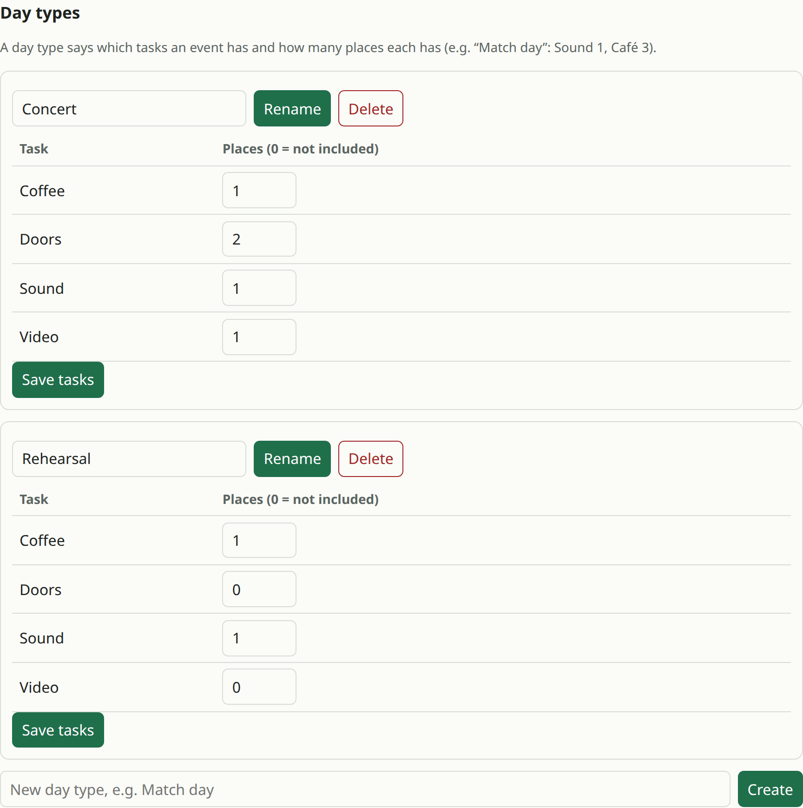

**Groups, and what can go together.** A *group* is a named set of people who work as one: a team, a couple. The members are
busy together, and each counts as having worked. For every pair of tasks you say whether they can be done by the same person on
the same day: *cannot*, *impractical*, *practical* or *preferred*.

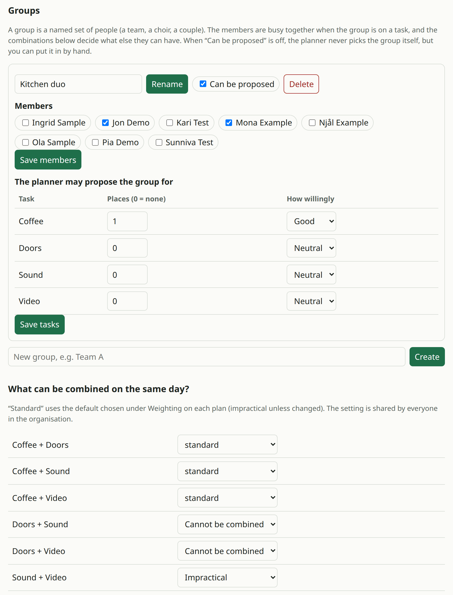

**One table for everything.** The plan page is a table with the events across. At the top of each column: the date and time,
the day type, a note, and the plan's own *info rows* (a theme, who hosts: whatever you need), which you add yourself and the
planner never reads. Then the places per task: a faded number comes from the day type, and you can type another one for a single
event. Below come the people, with a cell for each event. Two events can fall on the same day.

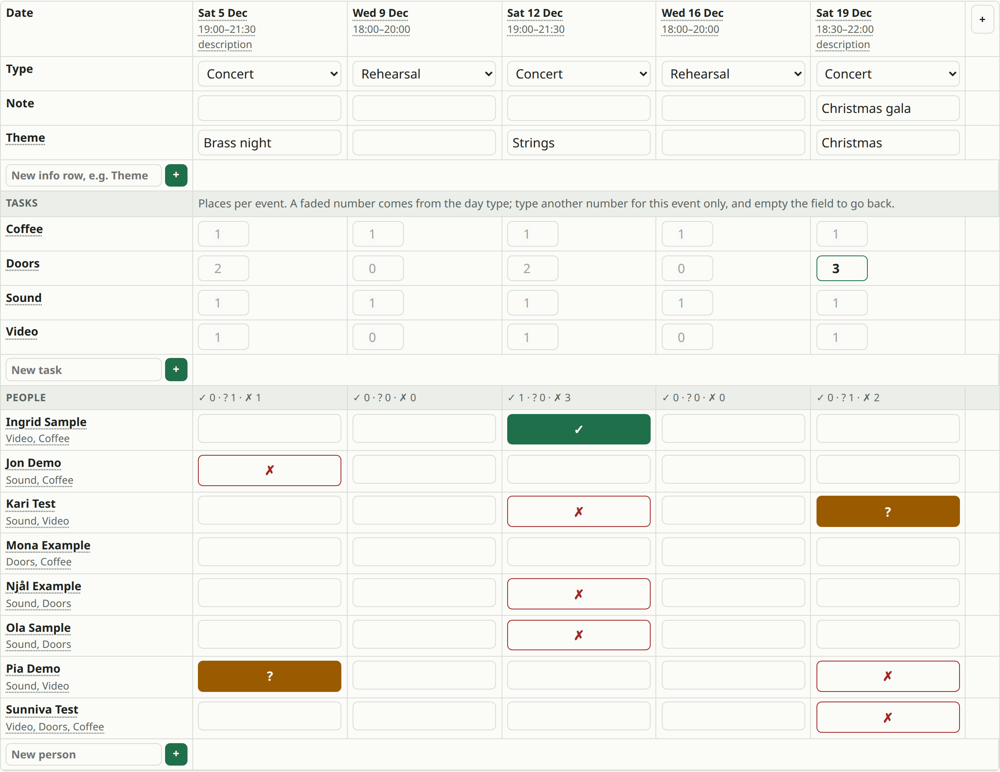

**Everyone answers in the same table.** Click a cell for ✓ *yes*, again for ? *maybe*, again for ✗ *no*, and once more to clear it;
an empty cell is not answered and counts as neutral. Each person has a link of their own that opens the table with their row
marked and their name filled in.

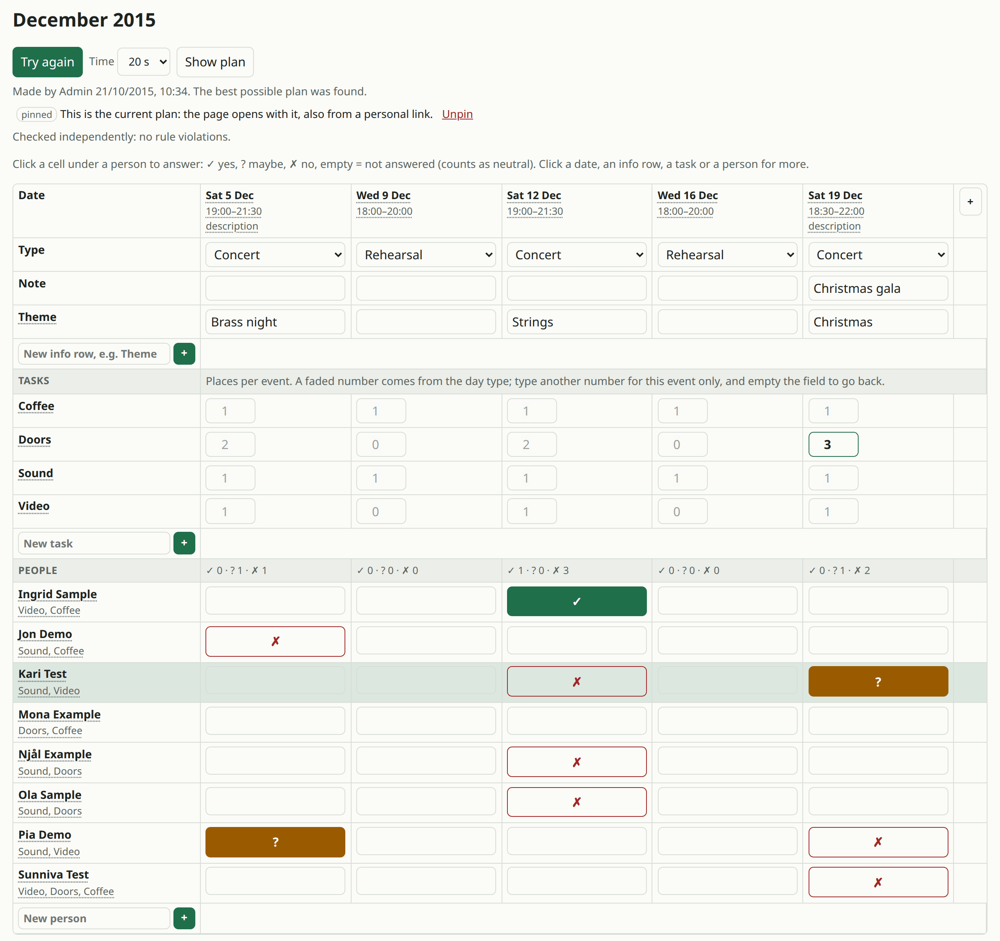

**The rest is one click away.** The name of a task opens its places per day type, what it can be combined with on the same
event (or *nothing at all*), and its name. The name of a person opens the tasks they take part in and how willingly, and their
personal link. A date opens the event's time, note and description. A whole season is added at once under the table
(*every Saturday from … to …*).

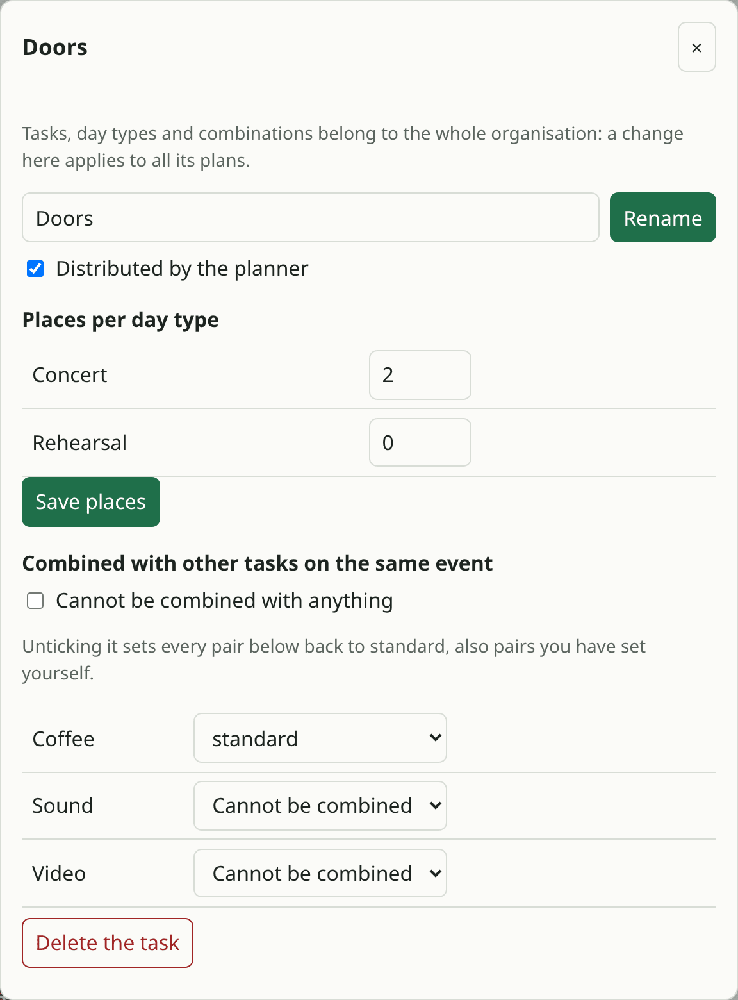
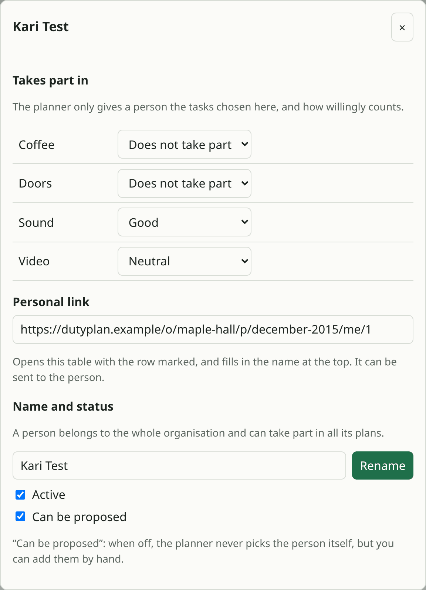
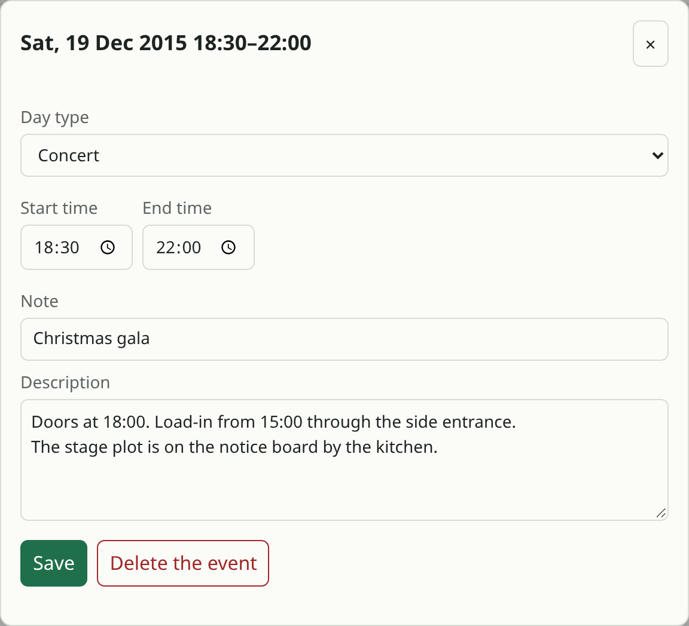

**A proposal you can read.** Press **Plan**, and *Show plan* puts the result into the table: who has each place, and in each
person's cell the task they got. A person can be *locked* onto a place with one click, and the planner never moves a locked
place. The planner is checked afterwards by a second, independent program, and the page says if a rule was broken (it should
never be).

**It says why.** When a place cannot be filled, the plan tells you the reason in plain words: who is outside the selection, who
cannot come, who has not chosen the task. Weak spots the planner had to accept are listed as *compromises*.

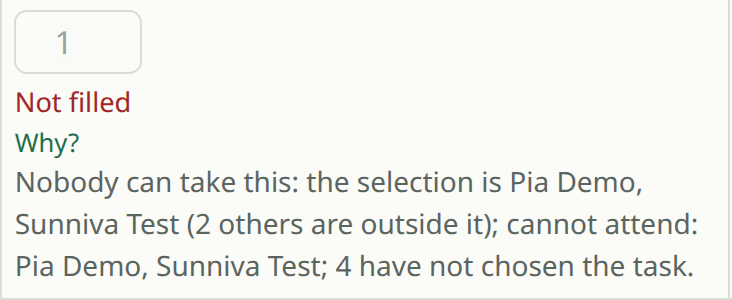

**Manual cells and selections.** A *manual cell* fixes a person (or a group, or a text) to a place; a *selection* says that
only these people can be picked for a task on an event, which covers things like *their own sound engineer* without any special
rule.

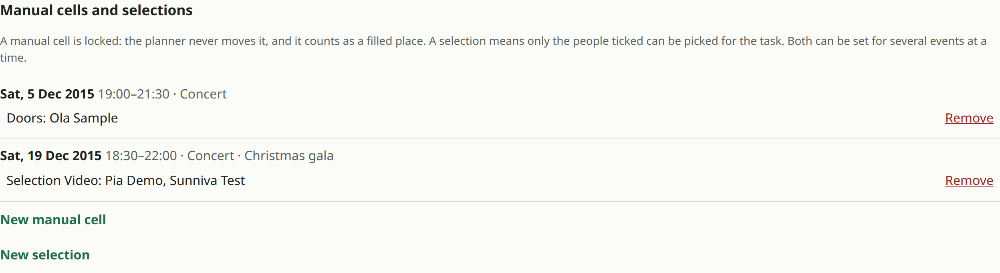

**Fair, and yours to tune.** «Even» means an equal *total* load: someone who only takes one task does not end up with half of
someone who takes two. The weights behind the proposal are configuration per plan, with defaults that work and limits that
keep them sane.

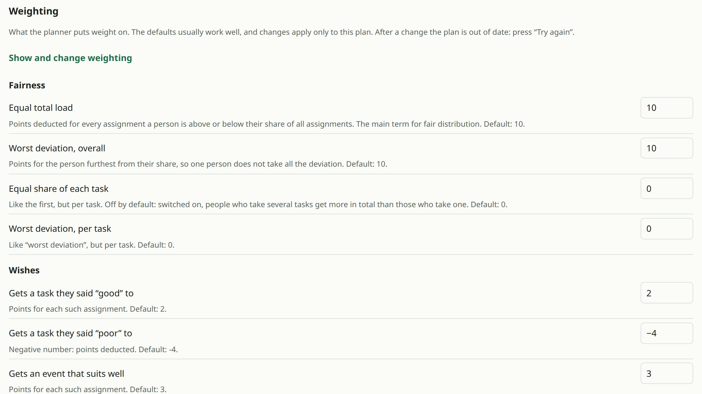

**Every run is kept, and one is the current plan.** Run again and compare. **Pin** a finished run as the plan's current plan:
the page opens with it, also from a personal link; with nothing pinned it opens with the newest. The distribution shows how
many turns each person got against their fair share.

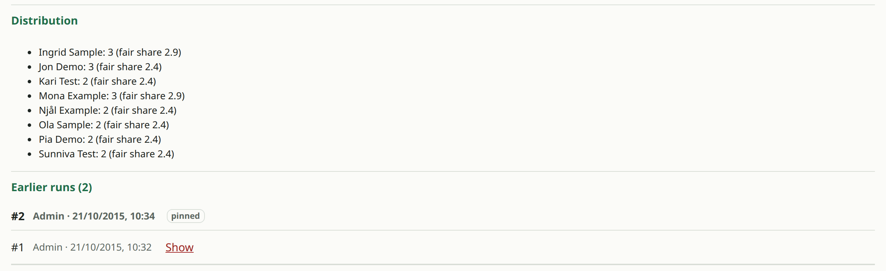

**English and Norwegian, on a phone.** The page follows the browser's language and has a switch in the header; the
explanations the planner writes follow it too. On a narrow screen the table scrolls sideways under the names.

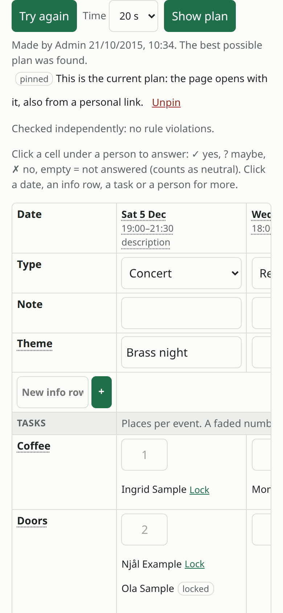
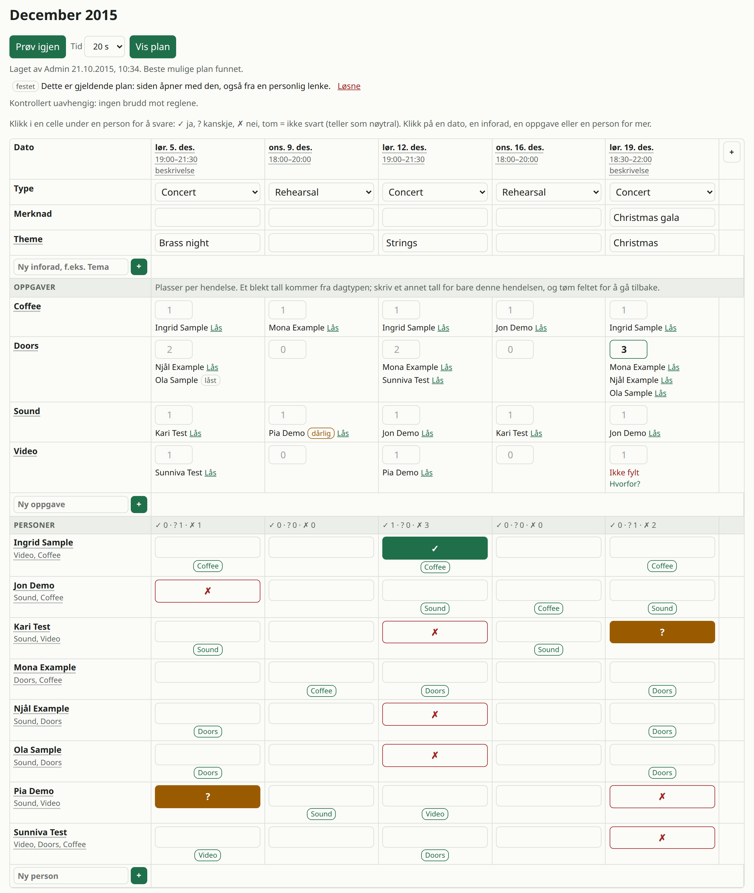

**Small to run.** One Go binary with the web page inside it and a SQLite file; the planner is a separate Python program that the
server starts when you press **Plan**. **No login**: read the warning below before you put it anywhere other people can reach.

## How it works

1. An **organisation** holds everything that is shared: people, tasks, day types, groups and the combinations.
2. An organisation has several **plans** (for example *December 2026*). A plan is a list of **events**, shown as one table.
3. Everyone answers in the plan's table. Each person's link (`/o/<organisation>/p/<plan>/me/<id>`; send it to them) opens the
   table with their row marked.
4. On the plan page, **Plan** runs the planner. Lock people, set selections, change the weighting, and run again.
5. Each run is kept. **Pin** the one you want to use.


Everything you create can be renamed, and plans and organisations can be deleted (an organisation only when it has no plans).
Every change is recorded in a change log with the name the person typed in under **Who are you?**.

## No login: where to run it

Anyone who can reach the address can read and change **everything**. The name in *Who are you?* is self-declared and is only
used in the change log; it is not authentication. So:

- run it on a network you trust (a home or office LAN), or
- put it behind a reverse proxy that does the authentication (HTTP basic auth, an identity-aware proxy, a VPN), and do not
  expose the port itself to the internet.

The server sends `X-Robots-Tag: noindex` and a strict Content-Security-Policy, but that only keeps it out of search engines.

## Requirements

| What | For | Version |
| --- | --- | --- |
| Go | building the server | 1.26 |
| Python with [OR-Tools](https://developers.google.com/optimization) | the planner (optional: without it everything works except **Plan**) | 3.12 (newer ones that OR-Tools has wheels for also work) |
| [mise](https://mise.jdx.dev) | the easy way to get both, pinned (see `mise.toml`) | recent |

The database is SQLite through a pure-Go driver, so there is nothing to install for it.

## Quick start

With mise:

```sh
mise install            # Go, Python and uv, in the versions pinned in mise.toml (once)
mise run up             # installs the Python packages, builds, starts on http://127.0.0.1:8080 and prints the address
```

`mise run up` is the whole thing in one command, and the only one you need after `mise install`. When the database file
(`dutyplan.db` in the current directory, or the one named by `--db`) does not exist yet, it first gets a small demo
organisation, *Test*, so there is something to look at. Arguments go to the server: `mise run up -- --addr 0.0.0.0:8080 --db /var/lib/dutyplan/dutyplan.db`.
Stop it with Ctrl-C.

The steps one by one: `mise run setup` (the Python packages, OR-Tools, for the planner), `mise run app:run` (starts the server
without building a binary or seeding), and `mise run app:seed -- http://127.0.0.1:8080` (fills a running server with the demo
organisation). `mise.toml` sets `DUTYPLAN_SOLVER` so that the server finds the planner. Open the address, create an
organisation (or use *Test*), add tasks and a day type under **Setup**, create a plan, add events and people, let people
answer, and press **Plan**.

Without mise:

```sh
go build -o dutyplan ./cmd/dutyplan

python3.12 -m venv planner-venv           # a Python that OR-Tools has wheels for
planner-venv/bin/pip install ./solver     # the planner and OR-Tools

DUTYPLAN_SOLVER="$PWD/planner-venv/bin/python -m dutyplan_solver" ./dutyplan --db /var/lib/dutyplan/dutyplan.db
```

## Options

| Flag | Default | |
| --- | --- | --- |
| `--addr` | `127.0.0.1:8080` | where to listen; port `0` picks a free one. Use `0.0.0.0:8080` to be reachable from other machines (see the warning above). |
| `--db` | `dutyplan.db` | the SQLite file; created if missing. Its directory must be writable (SQLite keeps `-wal` and `-shm` files next to it). |
| `--solver` | `$DUTYPLAN_SOLVER` | the command that starts the planner, split on spaces (no quoting). Empty means no planning. |
| `--workers` | CPUs, at most 8 | threads the planner may use. |

`DUTYPLAN_SOLVER` is the same as `--solver`. The server writes one line with its address to standard output and logs to
standard error. It stops cleanly on `SIGINT` and `SIGTERM`. A planner run that was going when the server stopped is marked as
failed at the next start.

Only one planner run goes at a time. A run has a time limit (10, 20 or 60 seconds on the page); it stops when it has found
the best plan or runs out of time, and says which.

## Data and backups

All data is one SQLite file (plus the `-wal`/`-shm` files while the server runs). The schema is upgraded automatically at
startup by forward-only migrations, so **take a backup before upgrading**. A consistent copy of a running server:

```sh
sqlite3 dutyplan.db ".backup 'dutyplan-backup.db'"
```

or stop the server and copy the three files. The 20 newest runs of each plan are kept, plus the pinned one; older runs are
removed when a new one starts.

Deleting a plan removes its events, the answers people gave for them, manual cells, selections and runs, and keeps the change
log. Deleting an organisation removes everything in it, its change log included, so that one deletion is written to the
server's log (standard error) instead.

## Development

Everything goes through mise; `mise tasks` lists the tasks.

| Task | |
| --- | --- |
| `mise run test` | all tests, Go and Python, quiet (about 15 s) |
| `mise run test:fast` | the quickest loop: Go and the planner's rule tests |
| `mise run mutations` | breaks every rule in turn and checks that a test fails (about 7 min) |
| `mise run app:smoke` | starts the server on a temporary database and checks the tenant isolation with curl |
| `mise run app:ui` | browser check of the page in both languages (needs `playwright-core` and Chromium; see the script) |
| `mise run app:shots` | makes the pictures in `docs/img` from the real app on invented data (about 30 s); run it again when the page changes visibly |
| `mise run verify` | tests, mutations and the smoke test: everything that must be green before a commit |

Layout: `cmd/dutyplan` (main), `internal/store` (SQLite, migrations, all data access), `internal/planner` (builds the planner's
input from the database, runs it, turns the answer into a view), `internal/api` (JSON API), `internal/i18n` (server texts),
`web/` (the page: plain JavaScript, no build step), `solver/` (the Python planner and its tests). `CLAUDE.md` holds the design
rules and conventions for anyone (or any assistant) working on the code; `PLAN.md` has the design notes.

## License

Apache License 2.0, see `LICENSE`.
