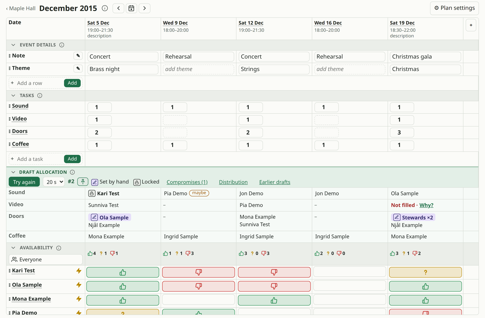
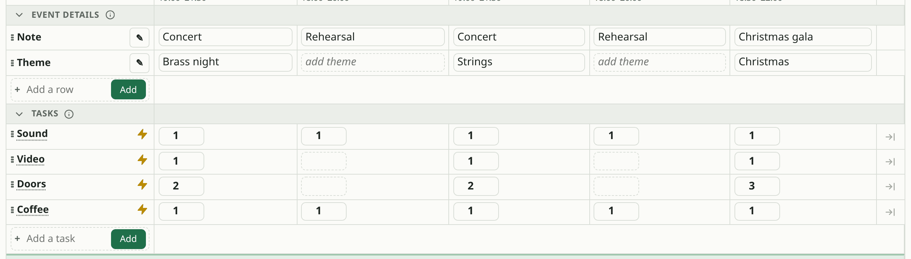
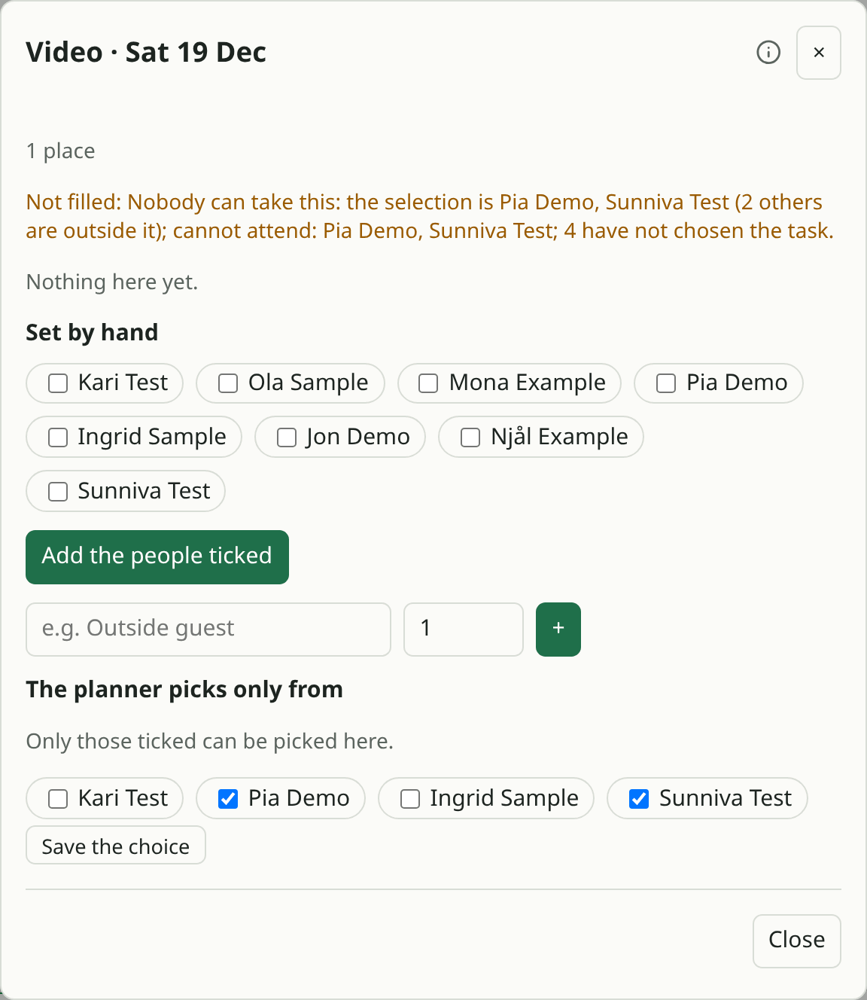
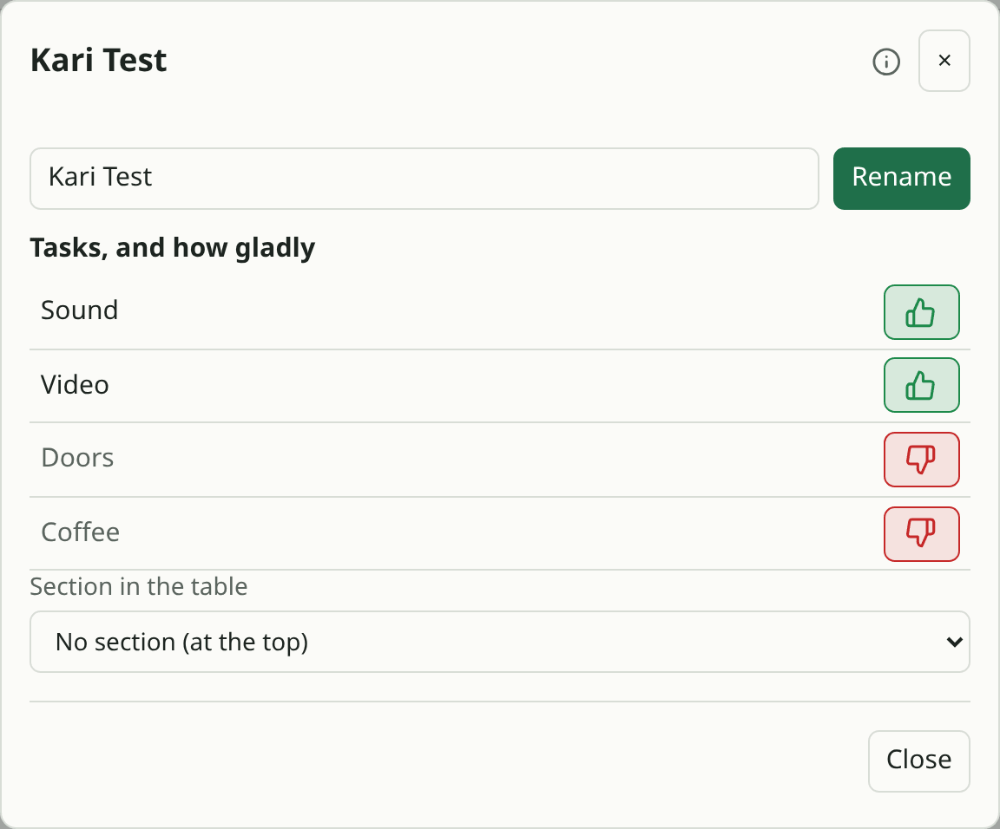
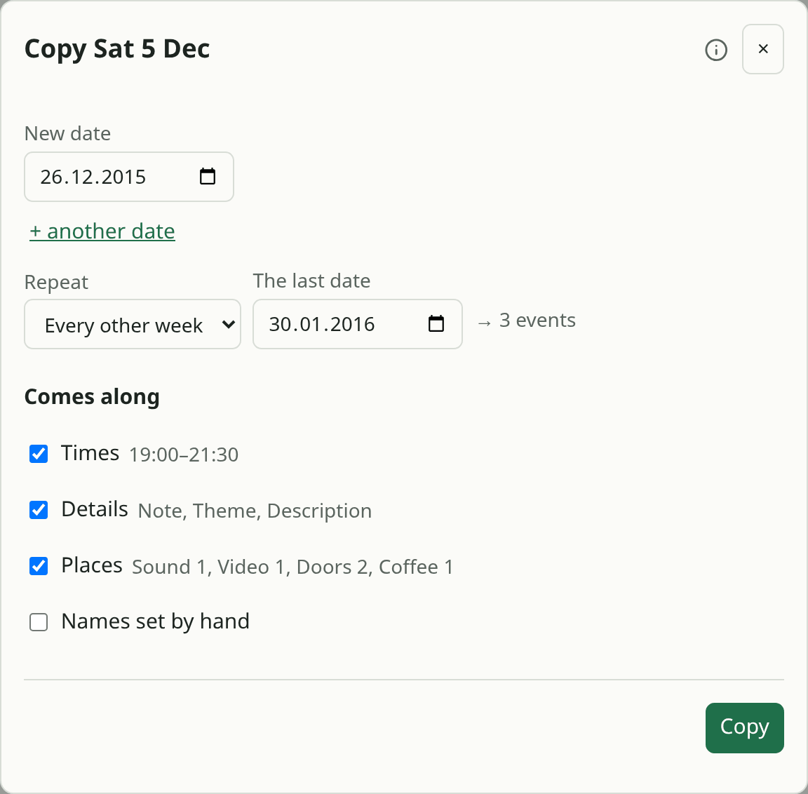
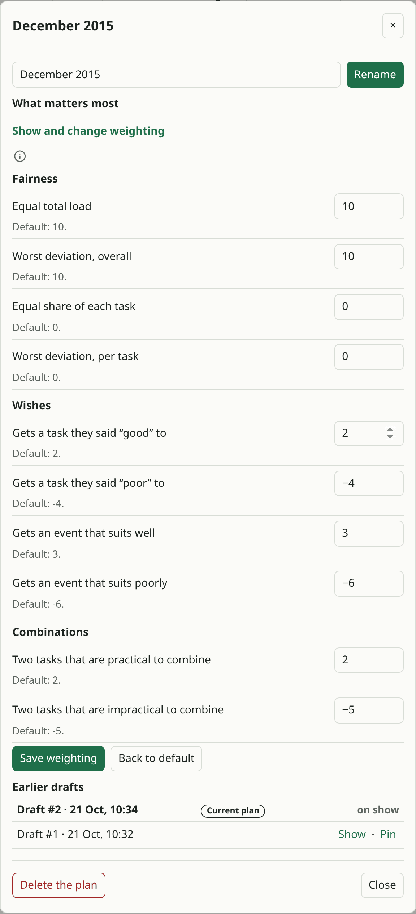
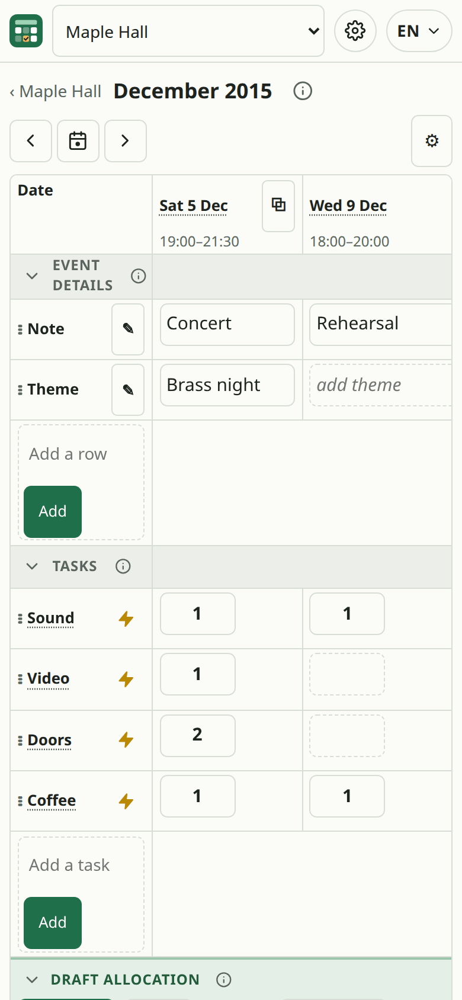
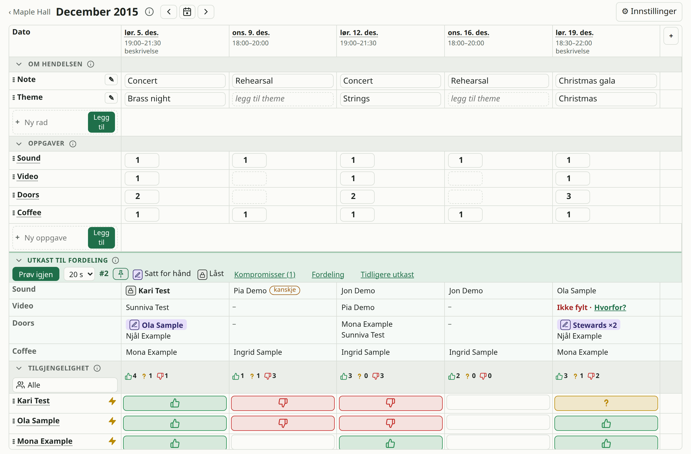

# Dutyplan

**Share out recurring duties fairly, and know why.** Who runs the sound on which Saturday, who is on the door, who brings the
coffee? People say what they can take part in and when they cannot; a planner proposes who does what as evenly as it can,
and tells you why a place stays empty.

[](https://github.com/gunnaringe/dutyplan/actions/workflows/ci.yml)
[](https://github.com/gunnaringe/dutyplan/pkgs/container/dutyplan)
[](LICENSE)




*Dutyplan* (*Tjenesteplan* in Norwegian) is a general tool. Tasks, people, events and the details shown for them are
all things you create yourself. The pictures here show a made-up community hall, *Maple Hall*, with invented people.

## The problem

A rota made by hand is a puzzle that never stays solved. Some people cannot on some days, some would rather not, two jobs
cannot be done by the same person on the same evening, a couple wants to work together, and somebody always ends up with twice
as many turns as the rest. Every change means starting again.

Dutyplan keeps the facts in one place and lets a constraint solver (OR-Tools CP-SAT) do the puzzle: press **Make a draft** and
you get a proposal that follows every hard rule, is as even as it can be, and says so when it cannot fill a place.

## What it does

**One table for the whole plan.** The plan page is a table with the events across. Read a column from the top: what the event
is, what it needs, who got it, and who can come. Two events can fall on the same day.

**Event details are yours.** Below the date and time come the plan's own rows (a note, a theme, who hosts: whatever you need).
You add them yourself, type straight into the cells, drag ⋮⋮ to move a row, and ✎ renames, moves or deletes it. The planner
never reads them.

**Each event has its own places.** A *task* is something to do (Sound, Video, Doors, Coffee). For every task and event you
type how many places there are: a concert needs two on the door, a rehearsal none. Nothing is built in. *Fill row* in a
task's dialog puts the same number on every event at once, and ⋮⋮ drags a task to another row (the order is the same in
every plan).



**The draft allocation.** Between the tasks and the answers is the draft: who has each place. What you set yourself has a
violet background and a ✎ square: a person, or a text such as *Stewards ×2* that fills places without being anyone. A name from the
planner can be **locked** with one click (a 🔒 square), and *Try again* keeps it. A place given against a *?* is marked *maybe*, and a place
that cannot be filled says *Not filled · Why?*. The planner is checked afterwards by a second, independent program, and the
page says if a rule was broken (it should never be).


**Everyone answers in the same table.** Under *Availability* each event has a count of the answers, and each person a row. Click
a cell for a green thumb up (*yes*), again for a yellow ? (*maybe*), again for a red thumb down (*no*), and once more to clear it;
an empty cell is not answered and counts as neutral. The ⚡ by a name says whether the planner may pick the person (off: only by
hand); one click switches it.

**A note on an answer.** Hover over a cell and click the small tab in its corner to write a note, such as *can come after 12*. A
cell with a note has an amber corner; hovering shows the note, and a click on the tab changes or deletes it. Notes stay when the
answer changes, and everyone who sees the answers sees them.

**Select many cells at once, as in a spreadsheet.** Drag over answers (or over the places of tasks) to select a block; Shift+click
extends it, Ctrl+click adds or takes away one cell, a click on ⋮⋮ selects a whole row, and a click on a day's count selects
everyone that day. A bar at the bottom then sets them all: 👍 ? 👎 or *Clear* for answers (or the keys 1, 2, 3 and Delete), a
number for places. Escape lets go. With more than eight people a *Filter names* box finds someone quickly, and the 👥 button
under *Availability* picks who the table shows: tick anyone you like (kept in your browser; the counts, the planner and the draft
still have everyone). Selecting is for a
mouse; on a phone you answer one cell at a time.

People are in the order you put them: ⋮⋮ drags a person to another row. *Sections* (for example *Guests* or *Not this term*)
are headings with their people below; drag a person onto one, or pick it in the person's dialog. They only place people in
the table, the same in every plan, and the planner never sees them. Deleting a section puts its people back at the top.


**It says why.** Click a place in the draft and you see what is set by hand and what came from the planner, can set people by
hand (tick as many as you like, also more than the places: the place then shows as fuller than it needs), and can say that the planner picks only from some people (*their own sound engineer*, without any special rule). When a
place cannot be filled, the reason is in plain words: who is outside the selection, who cannot come, who has not chosen the task.
Weak spots the planner had to accept are listed as *compromises*.



**Live, compact, and explained on request.** A click shows at once and is saved in the background; the page never reloads.
When someone else changes the plan (or a draft is ready) the page updates by itself, kept where it was. The dates and the names
stay in view while the table scrolls; move sideways with ‹ ›, the calendar button (the next event from today), the mouse wheel over the dates,
the arrow keys, or by dragging the table. Explanations are behind the ⓘ buttons instead of on the page. Each section of the table (and each section of people) folds with the arrow before its heading, to fit more on the screen; the page remembers it.

**The rest is one click away.** The name of a task opens what it can be combined with on the same event (or *nothing at all*)
and whether the planner fills it: one click per pair goes *can’t* → *bad* → *good*, and a pair that is not set is *bad*. The name of
a person opens the tasks they take part in: one click per task goes red thumb down (*can’t*) → yellow ? (*if needed*) → green
thumb up (*good*), and every task starts as *can’t*. A date opens the event's times, details and description.





**Events are easy to copy.** ⧉ on an event copies it to other dates, or repeats it until a date: every week, every other week,
or every 3 to 8 weeks. The times, the details, the places and the names set by hand come along if you want them. Answers are
never copied. **+** after the last event adds a new one, empty or as a copy, and can repeat it the same way. Each event is on its
own afterwards: nothing remembers the rhythm.



**Fair, and yours to tune.** «Even» means an equal *total* load: someone who only takes one task does not end up with half of
someone who takes two. The distribution shows how many turns each person got against their fair share. The weights behind the
proposal are configuration per plan, under ⚙ *Plan settings*, with defaults that work and limits that keep them sane.


**Every draft is kept, and one is the current plan.** Try again and compare. **Pin** a draft as the plan's current plan: the
page opens with it; with nothing pinned it opens with the newest. The earlier drafts are under ⚙,
with the weighting and the plan's name.



**The organisation.** An organisation's page lists its plans, and is where it is renamed or deleted.


**English and Norwegian, on a phone.** The page follows the browser's language and has a switch in the header; the
explanations the planner writes follow it too. On a phone it is the same table, narrower: the names stay put while the days
scroll sideways, and a tap answers.




**Small to run.** One Go binary with the web page inside it and a SQLite file; the planner is a separate Python program that the
server starts when you make a draft. People sign in with OpenID Connect (any provider: Pocket ID, Keycloak, Authentik, Google, ...),
and each sees only the organisations they are a member of.

## How it works

1. An **organisation** holds everything that is shared: people, sections, tasks and which tasks can be combined.
2. An organisation has several **plans** (for example *December 2026*). A plan is a list of **events**, shown as one table.
3. Everyone answers in the plan's table (a person is a row; the people who plan fill it in).
4. **Make a draft** runs the planner. Set places by hand, lock names, choose whom the planner picks from, change the weighting,
   and try again.
5. Each draft is kept. **Pin** the one you want to use.

Everything you create can be renamed, and plans and organisations can be deleted (an organisation only when it has no plans).

## Signing in

Someone who is not signed in sees a page that explains what this is, and **Sign in**. The first sign-in makes the account (at the
provider), and then they create an organisation, of which they are the admin. Nobody else sees that it exists.

| Who | May |
| --- | --- |
| **Admin** | everything a member may, and invite people, change roles, remove people, rename and delete the organisation |
| **Member** (joined by invitation) | make, change, share and delete plans; people, tasks and sections |
| **Edit link** to a plan | change everything in that plan (and the people and tasks its table needs); no account needed |
| **View link** to a plan | look at that plan |

**Sharing.** A member shares a plan with a link (**Share** on the plan): *view* or *edit*. It works until it is deleted or runs out,
shows only that plan, and never lets whoever has it make links. On the **Members** page (the people icon in the header) everyone sees the plans' links; an admin also makes
invitation links (whoever opens one and signs in becomes a member). Everyone may leave; there is always one admin.

Make a client at your OpenID Connect provider: confidential, with PKCE, the redirect address `<your address>/auth/callback` and,
for signing out at the provider too, the address `<your address>/` after logout. Then start the server with `--oidc-issuer`,
`--oidc-client-id`, `--oidc-client-secret-file` and `--public-url` (or the `DUTYPLAN_OIDC_*` and `DUTYPLAN_PUBLIC_URL`
variables). Sessions last 30 days, in a cookie of this host only.

**Without a login** (`--no-login`, or listening on `127.0.0.1` without `--oidc-issuer`) anyone who can reach the address can read and
change **everything**. That is for your own machine, or behind a reverse proxy that does the authentication; on any other address the
server refuses to start without one or the other. The server refuses writes from other sites (`Sec-Fetch-Site: cross-site`), and sends
`X-Robots-Tag: noindex` and a strict Content-Security-Policy.

**Limits.** With a login anyone with an account may sign up, so there are caps: one person owns at most 20 organisations; an
organisation has at most 100 plans, 1000 people, 200 tasks and 200 links; a plan at most 1000 events. Changes are rate limited per
person (or per address, for someone using a link): bursts of 300, then 5 a second; making an organisation or a link, or starting a
planning run, 20 at once and then one every 30 seconds. Beyond that the answer is `429` with `Retry-After`. Reading is not rate limited, and
without a login neither are changes. With a login the start page may be indexed by search engines; nothing else is.

## Requirements

| What | For | Version |
| --- | --- | --- |
| Go | building the server | 1.27 |
| Node | only the browser check and the pictures in `docs/img` | 26 |
| Python with [OR-Tools](https://developers.google.com/optimization) | the planner (optional: without it everything works except **Make a draft**) | 3.14 (3.12 and newer work, as far as OR-Tools has wheels for them: not 3.15 yet) |
| [mise](https://mise.jdx.dev) | the easy way to get both, pinned (see `mise.toml`) | recent |

The database is SQLite through a pure-Go driver, so there is nothing to install for it.

## Quick start

With mise:

```sh
mise install            # Go, Python, uv, Node and prek, in the versions pinned in mise.toml (once)
mise run up             # installs the Python packages, builds, starts on http://127.0.0.1:8080 and prints the address
```

`mise run up` is the whole thing in one command, and the only one you need after `mise install`. When the database file
(`dutyplan.db` in the current directory, or the one named by `--db`) does not exist yet, it first gets a small demo
organisation, *Test*, so there is something to look at. Arguments go to the server: `mise run up -- --addr 0.0.0.0:8080 --db /var/lib/dutyplan/dutyplan.db`.
Stop it with Ctrl-C.

The steps one by one: `mise run setup` (the Python packages, OR-Tools, for the planner), `mise run app:run` (starts the server
without building a binary or seeding), and `mise run app:seed -- http://127.0.0.1:8080` (fills a running server with the demo
organisation). `mise.toml` sets `DUTYPLAN_SOLVER` so that the server finds the planner. Open the address, create an
organisation (or use *Test*), create a plan, add events, tasks and people in its table, type the places, let people answer,
and press **Make a draft**.

Without mise:

```sh
go build -o dutyplan ./cmd/dutyplan

python3.14 -m venv planner-venv           # a Python that OR-Tools has wheels for
planner-venv/bin/pip install ./solver     # the planner and OR-Tools

DUTYPLAN_SOLVER="$PWD/planner-venv/bin/python -m dutyplan_solver" ./dutyplan --db /var/lib/dutyplan/dutyplan.db
```

As a container: the server and the planner in one image, for amd64 and arm64. Every push to `main` publishes it as
`ghcr.io/gunnaringe/dutyplan:main` (and as `main-<UTC time>-<commit>` and `sha-<commit>`, which never move):

```sh
podman run --rm -p 127.0.0.1:8080:8080 -e DUTYPLAN_NO_LOGIN=1 -v dutyplan-data:/data ghcr.io/gunnaringe/dutyplan:main
```

The database is `/data/dutyplan.db`, and the image runs as uid 10001, so a directory mounted at `/data` must be writable by it.
To build it yourself from `Dockerfile`: `podman build -t dutyplan .`, or `mise run app:image`, which tags it with the commit.
`main` is not a release: the schema can still change in ways an older database does not survive (see *Data and backups*).

## Options

| Flag | Default | |
| --- | --- | --- |
| `--addr` | `127.0.0.1:8080` | where to listen; port `0` picks a free one. Use `0.0.0.0:8080` to be reachable from other machines (with a login, see *Signing in*). |
| `--db` | `dutyplan.db` | the SQLite file; created if missing. Its directory must be writable (SQLite keeps `-wal` and `-shm` files next to it). |
| `--solver` | `$DUTYPLAN_SOLVER` | the command that starts the planner, split on spaces (no quoting). Empty means no planning. |
| `--workers` | CPUs, at most 8 | threads the planner may use. |
| `--oidc-issuer` | `$DUTYPLAN_OIDC_ISSUER` | the OpenID Connect provider to sign in with, e.g. `https://id.example.org`. |
| `--oidc-client-id` | `$DUTYPLAN_OIDC_CLIENT_ID` | the app's client at the provider. |
| `--oidc-client-secret-file` | `$DUTYPLAN_OIDC_CLIENT_SECRET_FILE` | a file with the client's secret. |
| `--public-url` | `$DUTYPLAN_PUBLIC_URL` | the address people open, e.g. `https://plan.example.org/`; the callback is `<address>auth/callback`. |
| `--oidc-signup-url` | `$DUTYPLAN_OIDC_SIGNUP_URL` | where someone without an account makes one (Pocket ID: `<issuer>/signup`); the start page links it. |
| `--client-ip-header` | `$DUTYPLAN_CLIENT_IP_HEADER` | the header a proxy in front puts the visitor's address in (`CF-Connecting-IP` behind Cloudflare), for the rate limits. Set it only when every request comes through that proxy. |
| `--no-login` | `$DUTYPLAN_NO_LOGIN=1` | no signing in: everyone who reaches the address may do everything (see *Signing in*). |

`dutyplan health [url]` asks a running server whether it is well (exit 0) or not (1), by default `http://127.0.0.1:8080/api/health`: a
container health check that needs no shell or curl in the image.

`DUTYPLAN_SOLVER` is the same as `--solver`. The server writes one line with its address to standard output and logs to
standard error. It stops cleanly on `SIGINT` and `SIGTERM`. A planner run that was going when the server stopped is marked as
failed at the next start.

Only one planner run goes at a time. A draft has a time limit (10, 20 or 60 seconds on the page); the planner stops when it has
found the best plan or runs out of time, and the draft says which.

## Data and backups

All data is one SQLite file (plus the `-wal`/`-shm` files while the server runs). The program is not released yet: the schema is
one file that is still changing, and a database made by another version is refused at startup (start with a new file). A
consistent copy of a running server:

```sh
sqlite3 dutyplan.db ".backup 'dutyplan-backup.db'"
```

or stop the server and copy the three files. The 20 newest drafts of each plan are kept, plus the pinned one; older ones are
removed when a new one starts.

Deleting a plan removes its events, its details rows, the answers people gave for them, what was set by hand, the selections and
the drafts. Deleting an organisation removes everything in it; the deletion is written to the server's log (standard error).

## Development

Everything goes through mise; `mise tasks` lists the tasks. `prek install` (once per clone) runs the checks of `prek.toml`
on every commit.

| Task | |
| --- | --- |
| `mise run lint` | the prek checks on the whole tree: YAML, JSON, TOML, gofmt, JavaScript syntax, no private keys or big files |
| `mise run test` | all tests, Go and Python, quiet (about 15 s) |
| `mise run test:fast` | the quickest loop: Go and the planner's rule tests |
| `mise run mutations` | breaks every rule in turn and checks that a test fails (about 7 min) |
| `mise run app:smoke` | starts the server on a temporary database and checks the tenant isolation with curl |
| `mise run app:ui` | browser check of the page in both languages (needs `playwright-core` and Chromium: `PLAYWRIGHT_CORE` and `CHROME`, see the script) |
| `mise run app:shots` | makes the pictures in `docs/img` from the real app on invented data (about 30 s); run it again when the page changes visibly |
| `mise run verify` | lint, tests, mutations and the smoke test: everything that must be green before a commit |
| `mise run app:image` | builds the container image as `localhost/dutyplan:<commit>` |

GitHub Actions runs the same checks on every pull request and on `main` (`.github/workflows/ci.yml`): the prek checks, the tests,
the smoke test, the browser check and the mutations. `.github/workflows/image.yml` builds the image for every pull request and publishes it from
`main` and from `v*` tags. Dependabot proposes updates to the Go and Python packages, the actions and the base images weekly.

Layout: `cmd/dutyplan` (main), `internal/store` (SQLite, the schema, all data access), `internal/planner` (builds the planner's
input from the database, runs it, turns the answer into a view), `internal/api` (JSON API), `internal/i18n` (server texts),
`web/` (the page: plain JavaScript, no build step), `solver/` (the Python planner and its tests). `CLAUDE.md` holds the design
rules and conventions for anyone (or any assistant) working on the code; `PLAN.md` has the design notes.

Security problems: see [SECURITY.md](SECURITY.md).

## License

Apache License 2.0, see `LICENSE`.
